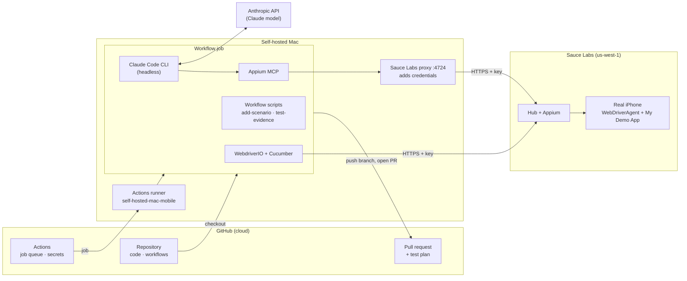
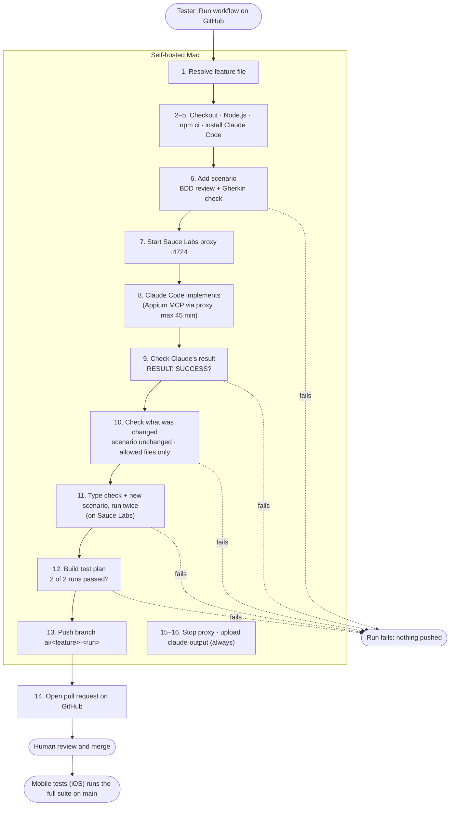

# wdio-appium-cucumber

Mobile UI tests for the **Sauce Labs My Demo App (iOS)**, written as Cucumber BDD scenarios and run with WebdriverIO and Appium on **real iPhones at Sauce Labs**. New scenarios can also be implemented by AI: a tester types a scenario into a GitHub form and gets back a pull request with tested automation code.

| | |
|---|---|
| Test runner | WebdriverIO 9 (`@wdio/cucumber-framework`) |
| Automation | Appium with the XCUITest driver, run by Sauce Labs (a local Appium 3 is kept for simulator runs) |
| Devices | Sauce Labs real iPhones (region `us-west-1`); local iOS simulator optional |
| Language | TypeScript (ESM, `.ts` import extensions) |
| BDD | Cucumber / Gherkin |
| Reports | Spec reporter (console) and Allure |
| CI | GitHub Actions on a self-hosted Mac (runs WebdriverIO only) |
| AI authoring | Claude Code with Appium MCP |

## Contents

- [How it works](#how-it-works)
- [Project layout](#project-layout)
- [Getting started](#getting-started)
- [Running the tests](#running-the-tests)
- [Writing tests](#writing-tests)
- [CI: Mobile tests (iOS)](#ci-mobile-tests-ios)
- [AI: Implement scenario (AI)](#ai-implement-scenario-ai)
- [One-time setup for CI](#one-time-setup-for-ci)
- [Known limitations and cost](#known-limitations-and-cost)
- [Troubleshooting](#troubleshooting)

---

## How it works

The framework has four layers, each built on the one below:

```
 ┌──────────────── 4. AI authoring (optional) ────────────────────┐
 │  /implement-feature skill  ·  "Implement scenario (AI)" workflow │
 ├──────────────── 3. CI on GitHub ───────────────────────────────┤
 │  "Mobile tests (iOS)" workflow → self-hosted Mac runner         │
 ├──────────────── 2. Test code (BDD) ────────────────────────────┤
 │  feature files → step definitions → page objects                │
 ├──────────────── 1. Automation engine ──────────────────────────┤
 │  WebdriverIO → Sauce Labs (Appium → XCUITest) → real iPhone      │
 └─────────────────────────────────────────────────────────────────┘
```

### 1. Automation engine

| Piece | Where | Job |
|---|---|---|
| **WebdriverIO** | Your Mac / the CI runner | Runs the tests. Code such as `$('~AddToCart').click()` becomes a WebDriver HTTP request, sent over HTTPS to Sauce Labs. |
| **Appium** | Sauce Labs | Receives those requests and passes them to the XCUITest driver. Sauce Labs runs it (`appiumVersion: 'latest'`); nothing is started on your Mac. |
| **XCUITest driver + WebDriverAgent** | Sauce Labs | Uses Apple's XCTest on the device to tap, type and read the screen. |
| **Real iPhone** | Sauce Labs | Any free iPhone (`iPhone.*`), e.g. an iPhone 13 Pro on iOS 18, running My Demo App 2.3.0 (`com.saucelabs.mydemo.app.ios`). |

**Reset between scenarios.** Each scenario must start on the catalog with an empty cart. Real devices can't clear app data (`mobile: clearApp` only works on simulators), so every scenario after the first gets a **new Sauce session**, which installs the app afresh (about 15 seconds). Each scenario then appears in Sauce Labs as its own job, named "Feature: Scenario", marked passed or failed, with its own video.

**Local simulator (optional).** `npm run test:local` uses `config/wdio.local.conf.ts` instead: a local Appium on port 4723, the iPhone 14 simulator, and the faster terminate → `mobile: clearApp` → activate reset.

### 2. Test code

```gherkin
Scenario: Remove a backpack from the cart
  Given the cart contains "Sauce Labs Backpack - Black"
  When I remove "Sauce Labs Backpack - Black" from the cart
  Then the cart should be empty
```

- **Feature files** describe the behaviour in plain English.
- **Step definitions** link each sentence to code. `{string}` and `{int}` capture values:
  ```ts
  When('I remove {string} from the cart', async (name: string) => {
      await CartScreen.removeItem(name);
  });
  ```
- **Page objects** hold the selectors: one class per screen. If the UI changes, one page object changes and every step using it keeps working.

### 3 and 4. Where everything runs

GitHub only queues jobs, stores secrets and hosts branches and pull requests. The self-hosted Mac runs WebdriverIO, Claude Code and Appium MCP. **Appium and the devices are at Sauce Labs.** Appium MCP reaches Sauce Labs through a small local proxy on port 4724, which adds the credentials, so Claude never sees them.



---

## Project layout

```
features/                     Gherkin feature files (written by humans)
  cart.feature
  checkout.feature
src/
  step-definitions/           One file per area: app, cart, checkout, …
  pageobjects/                One page object per screen, exported as a singleton
    base.screen.ts            Shared screen logic (waitForIsShown, isShown)
config/
  wdio.shared.conf.ts         Framework, reporters, .env loading, screenshot on failure
  wdio.sauce.conf.ts          Sauce Labs real devices: capabilities, new session per scenario, job names/results
  wdio.local.conf.ts          Local simulator: Appium service, capabilities, clearApp reset
scripts/
  sauce-proxy.mjs             Port-4724 proxy to Sauce Labs for Appium MCP (adds the credentials)
  sauce-upload.mjs            Uploads My Demo App to Sauce Labs app storage
apps/                         My_Demo_App.app for local simulator runs (not in git)
.env                          Your Sauce Labs credentials (not in git)
.github/
  workflows/
    mobile-tests.yml          Regression run on every push to main
    implement-scenario.yml    AI implementation of a new scenario
  scripts/
    add-scenario.mjs          Turns the one-line form input into Gherkin and adds it to a feature file
    scenario-lint.mjs         BDD review of a new scenario
    test-evidence.mjs         Builds the pull request's test plan from Allure results
    sync-feature-choices.mjs  Keeps the workflow's feature-file dropdown up to date
.claude/skills/implement-feature/
                              The /implement-feature skill used by Claude Code
.mcp.json                     Registers Appium MCP for Claude Code
CLAUDE.md                     Conventions and limitations Claude Code follows
```

The `.mjs` files are plain JavaScript modules that Node runs directly with no build step. They are tooling, not tests. The ones in `.github/scripts/` use the same Cucumber libraries as the test run (`@cucumber/gherkin`, `@cucumber/cucumber-expressions`).

---

## Getting started

### Prerequisites

- **Node.js 22**
- A **Sauce Labs account** with real-device access. Its username and access key are in Sauce Labs under the profile menu → **User settings**.
- Only for local simulator runs: Xcode 14.3.1 with the iPhone 14 simulator, and a simulator build of My Demo App in `apps/My_Demo_App.app` (or set `IOS_APP`).

### Install

```bash
git clone https://github.com/regisrozario/wdio-appium-cucumber.git
cd wdio-appium-cucumber
npm install
```

### Sauce Labs credentials and app

Create a `.env` file in the project root. It's git-ignored, so the credentials stay on your machine:

```bash
SAUCE_USERNAME=your-sauce-username
SAUCE_ACCESS_KEY=your-access-key
# SAUCE_REGION=us-west-1          # default; or us-east-4, eu-central-1
```

Upload the app to your Sauce Labs app storage once. This downloads My Demo App 2.3.0 (`SauceLabs-Demo-App.ipa`) from GitHub and uploads it:

```bash
npm run sauce:upload
```

Run it again whenever you want a newer build; the newest upload with that name is used.

---

## Running the tests

```bash
npm test                                                                    # all scenarios, on Sauce Labs
npm run test:smoke                                                          # @smoke only
TAGS='@checkout' npm test                                                   # by tag expression
npx wdio run ./config/wdio.sauce.conf.ts --spec ./features/cart.feature     # one feature file
npx wdio run ./config/wdio.sauce.conf.ts --spec ./features/cart.feature:11  # one scenario (line of "Scenario:")
npm run test:local                                                          # all scenarios, on the local simulator
```

The full suite takes about 5 minutes on Sauce Labs. Watch the runs live, with video, at [app.saucelabs.com](https://app.saucelabs.com) → Automated → Real Devices.

| Variable | Default | Purpose |
|---|---|---|
| `IOS_DEVICE` | Sauce: `iPhone.*` · local: `iPhone 14` | Device name. On Sauce Labs a regular expression, e.g. `iPhone 1[3-5].*` |
| `IOS_VERSION` | (any) | iOS version, e.g. `18` |
| `SAUCE_REGION` | `us-west-1` | Sauce Labs data center |
| `SAUCE_APP` | `storage:filename=SauceLabs-Demo-App.ipa` | App in Sauce Labs storage |
| `SAUCE_BUILD` | `Local run <date time>` | Build name grouping the jobs in Sauce Labs |
| `IOS_APP` | `apps/My_Demo_App.app` | Local runs only: path to the simulator build |
| `TAGS` | (all) | Cucumber tag expression |

### Checks without a device

```bash
npm run typecheck                          # TypeScript errors
npm run test:dry-run                       # every scenario's steps have definitions
npm run test:dry-run -- features/x.feature # one file; undefined steps are marked "Undefined." with a code snippet
```

### Reports and logs

```bash
npm run report         # builds and opens the Allure report
```

Each scenario in the Allure report links to its Sauce Labs job (video, device logs), and failed steps have a screenshot. WebdriverIO logs are in `logs/`.

### Editor support

`.vscode/settings.json` points the official Cucumber VS Code extension at `src/step-definitions/`, so steps resolve with Cmd-click and aren't shown as "Undefined step". Reload the window after cloning.

---

## Writing tests

### Selectors

Use, in this order:

1. accessibility id: `~Cart-screen`
2. `-ios predicate string`: `label BEGINSWITH "Oh no!"`
3. `-ios class chain`: `**/XCUIElementTypeCell[$name == "…"$]`

**Never XPath, never coordinates.**

- Some labels have **hidden duplicates**, such as the cart's hidden "No Items" label. When a label can appear twice, add `AND visible == 1` to the predicate.
- Read text field values with `toHaveAttribute('value', …)`. The iOS driver doesn't support `toHaveValue`.

### Page objects

- Extend `BaseScreen` with the screen's root selector, usually `~<Name>-screen`.
- Look elements up inside `this.screen.$(...)`, so matches stay within the screen.
- Export a singleton: `export default new CartScreen();`

### Step definitions

- Keep steps thin: they call page-object methods and assert with WebdriverIO's `expect` (`toBeDisplayed`, `toHaveText`, …). `expect` retries until the wait timeout, so **don't add sleeps**.
- **Reuse existing steps.** Check every file in `src/step-definitions/` before adding one.
- Use Cucumber expressions (`{string}`, `{int}`), not regexes.

### Scenarios (BDD rules)

- **One behaviour per scenario:** Given (setup) → When (action) → Then (outcome). Don't put a `When` after a `Then`.
- Write in the user's words: `I remove "X" from the cart`, not `click Remove`.
- Use the first person ("I …") consistently.
- Reuse the wording of existing steps instead of near-synonyms.
- Never put selectors, coordinates or fixed waits in a scenario.

The AI workflow enforces these rules on new scenarios (see [Scenario review](#scenario-review)).

### Code style

4-space indent, single quotes, short JSDoc only where something is non-obvious.

---

## CI: Mobile tests (iOS)

`.github/workflows/mobile-tests.yml` is the regression run. It has no AI involved.

- **Triggers:** every push to `main` (including merged AI pull requests), or **Run workflow** with an optional tag expression (e.g. `@smoke`) and Sauce device name.
- **Runs on:** the self-hosted Mac (`[self-hosted, macOS]`), with a 60-minute limit. The Mac only runs WebdriverIO; the tests run on Sauce Labs real iPhones.
- **Steps:** check out → Node.js 22 → `npm ci` → type check → check the Sauce credentials → `npm test` → generate the Allure report → upload the report and logs as artifacts.

The jobs appear in Sauce Labs under the build "Mobile tests (iOS) #\<run number\>". The suite takes about 5 minutes.

---

## AI: Implement scenario (AI)

A tester types one Gherkin scenario into a GitHub form. About 10 to 30 minutes later there is a pull request with step definitions and page objects, written by Claude Code after exploring the app through **Appium MCP**. **No pull request is opened unless the new scenario passes twice in a row** on Sauce Labs real iPhones.

### Starting a run

On GitHub, open **Actions → Implement scenario (AI) → Run workflow**:

| Input | Type | Example |
|---|---|---|
| `scenario` | Text, one line | `@smoke Scenario: Add the bike light \| When I open the product "Sauce Labs Bike Light" \| And I add the product to the cart \| And I open the "Cart" tab \| Then the cart should contain 1 item` |
| `feature_file` | Dropdown | `features/cart.feature`, `features/checkout.feature`, or `New feature file…` |
| `new_feature_file` | Text, optional | `features/catalog-sort.feature` (only with "New feature file…") |
| `runner` | Text | `macOS` (default): the self-hosted runner label |

Scenario format:

- Parts are separated by ` | ` (space, pipe, space), because GitHub's form only accepts one line.
- Start with `Scenario: <name>`, optionally preceded by tags such as `@smoke`.
- Then add steps starting with Given, When, Then, And or But, with at least one When and one Then.
- The name must be new in that feature file.
- Data tables and Scenario Outlines aren't supported in this form.

The dropdown is a fixed list in the workflow file. After adding or removing a feature file, run `npm run sync:feature-choices` and commit.

### End-to-end flow



### Step by step

The job has 16 steps and a 90-minute limit. Steps 1 to 14 stop at the first failure; steps 15 and 16 always run.

1. **Resolve feature file.** Takes the dropdown choice, or the `new_feature_file` path when "New feature file…" is chosen.
2. **Check out code** from the branch the workflow was started from.
3. **Set up Node.js 22.**
4. **Install dependencies** (`npm ci`): WebdriverIO, Cucumber and the other tools, into the job's own folder.
5. **Install Claude Code**, pinned to version 2.1.81.
6. **Add scenario to feature file** (`add-scenario.mjs`):
   - splits the input on ` | `
   - runs the **BDD review**
   - checks that the result parses as Gherkin
   - appends it to the feature file, or creates the file

   A copy of the feature file is kept for step 10.
7. **Start the Sauce Labs proxy** on port 4724 (`npm run explore`) and wait until it's ready. Only this step gets the Sauce credentials. The workflow owns the proxy, so Claude never starts or stops it.
8. **Implement with Claude Code.** Runs `claude -p` headless, with a 45-minute limit, using the `/implement-feature` skill and the rules in `CLAUDE.md`. Claude:
   1. runs a dry run to list the undefined steps
   2. explores the app through Appium MCP on a Sauce Labs iPhone: reads screens, generates locators, taps and scrolls, and confirms each selector
   3. writes page objects and step definitions under `src/`
   4. runs the type check, then runs the new scenario (through the proxy, `SAUCE_HUB_URL`) and fixes it until it passes
   5. writes its report to `.ai-result.md`, ending in `RESULT: SUCCESS` or `RESULT: BLOCKED - <reason>`
9. **Check Claude's result.** Any result other than `RESULT: SUCCESS` fails the run. Turns, cost and any refused tools are added to the run summary.
10. **Check what was changed.** Stops the proxy. Then confirms the scenario text is unchanged and that only `src/`, that feature file and `CLAUDE.md` changed.
11. **Verify.** Runs `npm run typecheck`, clears old results, and runs **only the new scenario, twice** (`--spec <feature>:<line>`) on Sauce Labs, with the credentials given to this step only.
12. **Build test plan** (`test-evidence.mjs`). Reads the Allure results and requires **2 of 2 runs passed, with every step passed**.
13. **Push branch** `ai/<feature>-<run number>`, committed as github-actions[bot].
14. **Open pull request.**
15. **Stop the Sauce Labs proxy** (always).
16. **Upload the `claude-output` artifact** (always): Claude's output, the test plan, the scenario review, the proxy log, logs and Allure results.

### Scenario review

`scenario-lint.mjs` reviews the new scenario in step 6, before any AI time is spent.

| Errors: the run stops | Warnings: reported, the run continues |
|---|---|
| Steps out of Given → When → Then order (e.g. a `When` after a `Then`) | A step worded almost like an existing step; the existing wording is suggested |
| `And`/`But` as the first step | UI wording: click, tap, press, swipe, scroll, button |
| Empty or generic scenario name ("X", "Test 1") | Mixing "I …" and "the user …" |
| Selectors, accessibility ids, coordinates or fixed waits in a step | More than 8 steps |

The review also lists which steps already exist and which are new. It appears in the run summary and in the pull request.

### Safety gates

Every gate below can stop the run. When one fails, nothing is pushed or published, and the run summary and the `claude-output` artifact explain why.

| Step | Gate | Fails when |
|---|---|---|
| 1 | Feature file choice | "New feature file…" has no path, or the path already exists |
| 6 | Scenario input and BDD review | Bad path, no `Scenario:` line, no When or Then, duplicate name, invalid Gherkin, or a review error |
| 8 | Time limit | Claude Code runs for more than 45 minutes |
| 9 | Claude's verdict | Claude reports `BLOCKED`, errors, or doesn't end with `RESULT: SUCCESS` |
| 10 | Scenario unchanged | The feature file differs from the copy kept in step 6 |
| 10 | Allowed files | Anything outside `src/`, that feature file and `CLAUDE.md` changed |
| 11 | Type check and runs | A type error, or the new scenario fails in either run |
| 12 | Evidence | Fewer than 2 runs passed, or a step was failed, pending or skipped |

Steps 1 and 6 run before Claude starts, so bad input costs nothing. The verification in steps 11 and 12 is done by the workflow itself, not taken from Claude's report.

### Guardrails for unattended Claude

- **No credentials for Claude.** The Sauce credentials go only to the proxy step and the verification step. Claude reaches Sauce Labs only through the proxy, for both exploration and its own test runs.
- **Tool allowlist.** Claude can only read and edit files, use Appium MCP, and run the dry run, the type check, `npx wdio run`, the port-4724 status check, and `git status` / `git diff`. It can't push, install packages or run anything else.
- **`CLAUDE_CODE_DISABLE_BACKGROUND_TASKS=1`.** A headless `claude -p` waits for background commands before exiting. A forgotten background server once kept a run idle for 20+ minutes. With this setting every command runs in the foreground, so nothing can be left behind.
- **`BASH_DEFAULT_TIMEOUT_MS=900000` and `BASH_MAX_TIMEOUT_MS=1800000`** give foreground test runs up to 15 minutes (30 on request), instead of the default 2.
- **The report goes to a file** (`.ai-result.md`), so late messages can't replace the `RESULT:` line.

### The pull request

The pull request is titled "Implement scenario: \<name\>" and its description contains:

1. One line naming the scenario and feature file, with a link to the workflow run.
2. When a new feature file was created, a reminder to run `npm run sync:feature-choices` after merging.
3. The full feature file, folded.
4. **Test plan:**
   - checks: scenario unchanged, allowed files only, type check passed, new scenario passed 2 of 2 runs
   - a table with one row per step and one column per run, plus each run's duration
5. **Scenario review:** errors, warnings, reused steps and new steps.
6. Claude Code's own summary of the steps, page objects and selectors it added.

Only the new scenario runs in this workflow. The **full suite** runs in Mobile tests (iOS) after the merge to `main`. Reviewers check the selectors and steps before merging; nothing reaches `main` without that review.

### Ports and servers

| Port | What | Started by | Used for |
|---|---|---|---|
| 4724 | Sauce Labs proxy (`npm run explore`) | The AI workflow (steps 7–10), or the `/implement-feature` skill locally | Appium MCP exploration, and Claude's test runs in CI |
| 4724 | Local Appium (`npm run explore:local`) | You, by hand | Exploring the local simulator instead |
| 4723 | Local Appium (wdio Appium service) | `npm run test:local` | Local simulator runs only |

`npm test` doesn't use a local port: WebdriverIO talks to Sauce Labs directly.

Both workflows use the concurrency group `sauce-labs`, so only one job uses Sauce devices at a time (plans limit concurrent devices) and a second run waits in the queue.

### Implementing locally with Claude Code

In a Claude Code session in this project, run:

```
/implement-feature features/cart.feature
```

Claude follows the same loop: dry run, explore, write code, run until it passes. You watch it work, and nothing is committed unless you ask. Locally, the skill starts the Sauce Labs proxy (`npm run explore`) itself, using your `.env`, and stops it when done (`npm run explore:stop`).

Appium MCP is registered in `.mcp.json` (`appium-mcp@1.99.2`). It runs in **remote mode** against `http://127.0.0.1:4724`. For sessions Appium MCP creates, the proxy replaces the requested device and app with the project's Sauce Labs ones (a real iPhone with My Demo App), and gives them 10 minutes between commands. `CLAUDE.md` has the exact session settings.

---

## One-time setup for CI

Both workflows need the runner and the Sauce Labs secrets. The AI workflow also needs the Anthropic key and the pull request permission.

- [ ] Add the repository secrets **`SAUCE_USERNAME`** and **`SAUCE_ACCESS_KEY`** (Settings → Secrets and variables → Actions). If your account isn't in US West, also add the repository **variable** `SAUCE_REGION` (`us-east-4` or `eu-central-1`).
- [ ] Upload the app to Sauce Labs once: `npm run sauce:upload` on any machine with the credentials in `.env`.
- [ ] Add the repository secret **`ANTHROPIC_API_KEY`**. Without it, the AI run stops at step 8.
- [ ] Under Settings → Actions → General → Workflow permissions:
  - choose **Read and write permissions**
  - tick **Allow GitHub Actions to create and approve pull requests**

  Without this, step 14 fails with a 403.
- [ ] Run the self-hosted runner **`self-hosted-mac-mobile`** (labels `self-hosted`, `macOS`) as a service, so it survives logouts and reboots:
  ```bash
  cd ~/actions-runner-mobile && ./svc.sh install && ./svc.sh start
  ```
  Otherwise, start it from a terminal with `./run.sh`.

The Mac needs only Node.js (Xcode only for local simulator runs). It must stay logged in and awake; a sleeping Mac leaves jobs queued.

Keep the repository **private**. Anyone who can start a workflow can run code on that Mac.

---

## Known limitations and cost

| Limitation | Effect | Workaround today |
|---|---|---|
| The software keyboard can't be dismissed on the local iOS 16.4 simulator (Return, swipes, `hideKeyboard`, backgrounding all fail); not yet checked on Sauce real devices | The Login and To Payment buttons stay covered after typing | Login uses the app's built-in username list (`bob@example.com` / `10203040`); checkout stops after login |
| Real devices can't clear app data | Each scenario needs a new Sauce session | A new session per scenario (about 15 s each), set up in `wdio.sauce.conf.ts` |
| Sauce assigns any free iPhone matching `iPhone.*` | Model and iOS version can differ between scenarios | Narrow `IOS_DEVICE` / `IOS_VERSION` if a scenario depends on them |
| The catalog loads lazily (about 6 products exist until you scroll) | `scrollIntoView` and `mobile: scroll` without an element don't move the grid | `mobile: scroll` with the CollectionView's `elementId` (see `CatalogScreen.openProduct`) |
| One-line scenario input | No data tables or Scenario Outlines | Add those scenarios by hand |
| Fixed dropdown list | New feature files don't appear automatically | `npm run sync:feature-choices` after merging |
| macOS 13 with Xcode 14.3.1 (local simulator runs) | XCUITest driver pinned to 11.17.7, because newer versions don't build; appium-mcp's native module doesn't build | Don't upgrade the driver; Appium MCP runs in remote mode |
| Claude Code pinned to 2.1.81 in CI | Newer versions aren't picked up | Raise the pin in the workflow after testing |
| Only new scenarios are reviewed | Existing scenarios aren't checked against the BDD rules | Fix them by hand |

**Cost.** Test runs use Sauce Labs device minutes: the full suite takes about 5 minutes, and each AI run adds exploration time plus two runs of the new scenario. Each AI run also calls the Anthropic API. A short headless check cost about $0.06. A full implementation is expected to cost a few dollars and take 10 to 30 minutes. The actual cost of each run is shown in its run summary.

---

## Troubleshooting

| Symptom | Fix |
|---|---|
| A step is marked `Undefined.` in the dry run | Add the step definition, or reword the scenario to match an existing step |
| `Missing credentials` / 401 from Sauce Labs | Check `SAUCE_USERNAME` and `SAUCE_ACCESS_KEY` in `.env` (locally) or the repository secrets (CI), and `SAUCE_REGION` |
| Sauce Labs can't find the app | Run `npm run sauce:upload` |
| A Sauce run waits a long time before starting | No matching device is free; widen `IOS_DEVICE` or wait. Sessions time out after 5 minutes |
| "Undefined step" warnings in VS Code, but the dry run passes | Reload the window; the Cucumber extension reads `.vscode/settings.json` |
| Port 4724 already in use | `npm run explore:stop` |
| Local simulator: app not found | Copy it to `apps/My_Demo_App.app` or set `IOS_APP` |
| Local simulator: first run is slow | WebDriverAgent is being built; later runs reuse it |
| AI run fails with a 403 when opening the PR | Enable the workflow permission in [One-time setup for CI](#one-time-setup-for-ci) |
| AI run fails at "Add scenario" | Read the scenario review in the run summary; fix the scenario and run again |
